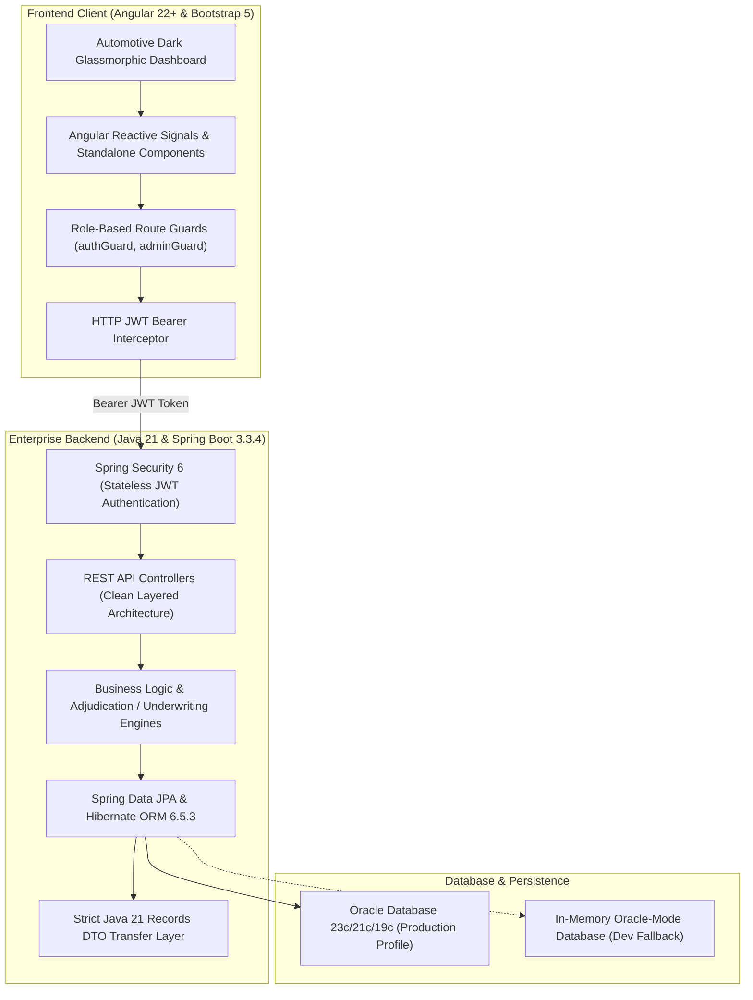
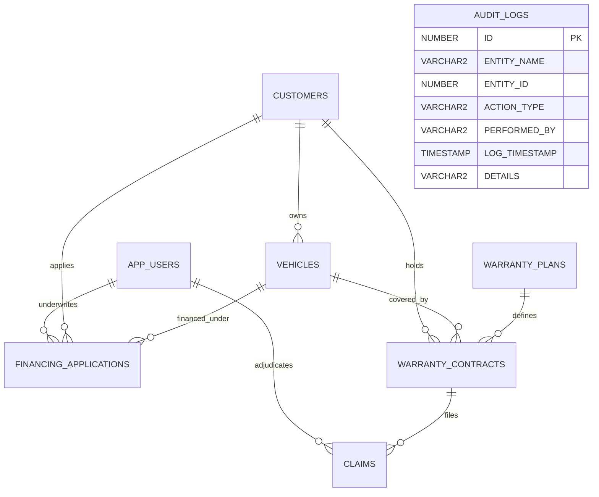

# 🚗 WarrantyWave — Automotive Warranty & Financing Platform

[](https://openjdk.org/projects/jdk/21/)
[](https://spring.io/projects/spring-boot)
[](https://angular.dev/)
[](https://getbootstrap.com/)
[](https://www.oracle.com/database/)
[](LICENSE)

**WarrantyWave** is an enterprise-grade, full-stack automotive financial operating system engineered for vehicle warranty policy lifecycle management, claims adjudication, auto loan/lease financing, credit risk assessment, and regulatory audit compliance.

---

## 🏗️ Architecture & Technology Stack



- **Backend**: Java 21 (LTS), Spring Boot 3.3.4, Spring Data JPA, Hibernate 6.5.3, Spring Security 6 (Stateless JWT HMAC-SHA256), OpenAPI/Swagger UI.
- **Frontend**: Angular 22+, TypeScript 6, Bootstrap 5, Reactive Signals, Standalone Components, Custom Responsive Automotive Theme.
- **Database**: Oracle Database (19c, 21c, and 23c/23ai compatible). Includes explicit DDL schemas, constraints, sequences, and seed data.
- **API & Tooling**: Maven 3.9+, Git, GitHub, Postman Collection, OpenAPI 3.0 / Swagger UI.
- **Testing**: JUnit 5, Mockito, Spring Security Test, Vitest for Angular.

---

## 🏎️ Core Enterprise Modules

### 1. Warranty Claims Processing Engine
- **Adjudication Workflow**: Claims officers review repair shop diagnostic estimates, itemized part replacements, and labor hours.
- **Deductible Application**: Automatically applies policy deductibles (e.g., \$100 or \$250) against estimates and enforces plan maximum claim caps (`maxClaimLimit`).
- **Two-Stage Settlement Lifecycle**: `SUBMITTED` $\rightarrow$ `UNDER_REVIEW` $\rightarrow$ `APPROVED` / `REJECTED` $\rightarrow$ `PAID` (Disbursed).
- **Exclusion Clause Documentation**: Formally registers contractual exclusion codes and narrative justifications upon claim denial.

### 2. Vehicle Financing & Leasing
- **Underwriting Engine**: Calculates applicant Debt-to-Income (DTI) ratio from verified monthly income and proposed vehicle installment.
- **Flexible Loan Terms**: Supports 24, 36, 48, 60, 72, and 84-month amortization schedules.
- **Amortized Monthly Payment Formula**:
  $$EMI = \frac{P \times r \times (1 + r)^n}{(1 + r)^n - 1}$$
  *Where $P$ = Principal Loan, $r$ = Periodic Monthly Interest Rate, $n$ = Term in Months.*

### 3. Credit Assessment Engine
- **Automated FICO Risk-Tier Categorization**:
  - **Tier 1 (Prime 750+)**: 5.25% APR — Lowest risk, prime tier financing.
  - **Tier 2 (Good 670–749)**: 6.49% APR — Standard favorable rates.
  - **Tier 3 (Fair 580–669)**: 9.99% APR — Conditional underwriting; requires DTI evaluation.
  - **High Risk (<580)**: 15.49% APR — Subprime tier; requires enhanced down payment and officer sign-off.
- **Interactive Financial Calculator**: Dynamic sliders for vehicle price, down payment, loan term, and FICO score with instant monthly payment and interest breakdown.

### 4. Contract Lifecycle Servicing & Renewals
- **Telematics Eligibility Verification**: Pre-validates vehicle age (max 7–12 years) and current odometer mileage against plan criteria before issuing coverage.
- **Servicing & Contract Renewals**: In-flight policy extension workflow extending term months and mileage thresholds with automated premium recalculation.

### 5. Customer & Fleet Management
- **Customer Profiles**: Full tracking of FICO score, annual income, employment classification, and contact telemetry.
- **Fleet Registry**: Standard 17-character ISO 3779 VIN validation, odometer tracking, purchase pricing, and condition tags (`NEW`, `CERTIFIED_PRE_OWNED`, `USED`).

### 6. Executive Operations Dashboard & Compliance Audit
- **Executive Telematics Metrics**: Active Contracts, Financing Volume, Settled Claims, Monthly ARR Run-Rate, and **Claims Loss Ratio %** with automated underwriting health indicators:
  $$\text{Loss Ratio} = \left(\frac{\text{Total Approved Claims Settled}}{\text{Total Monthly Premium ARR}}\right) \times 100$$
- **Warranty Product Distribution**: Real-time breakdown across protection tiers: *Powertrain Plus Shield*, *Comprehensive Gold Guard*, *Bumper-to-Bumper Platinum*, and *EV Volt & Drivetrain Shield*.
- **Immutable Audit Trail**: Regulatory journal capturing all administrative state mutations, approvals, and disbursements with timestamps, operator identity, and narrative logs.

---

## 🗄️ Database Design (Oracle Database)

The database schema is fully defined in [`database/schema-oracle.sql`](database/schema-oracle.sql) and pre-seeded in [`database/seed-data-oracle.sql`](database/seed-data-oracle.sql):



- **Data Integrity Constraints**: `CHK_VIN_LEN` (exactly 17 chars), `CHK_CREDIT_SCORE` (300–850), `CHK_CLAIM_STATUS`, `CHK_CONTRACT_STATUS`, `CHK_FINANCE_STATUS`.
- **Performance Indexes**: High-throughput indexing on `CUSTOMERS(EMAIL)`, `VEHICLES(VIN)`, `VEHICLES(CUSTOMER_ID)`, `WARRANTY_CONTRACTS(STATUS)`, `CLAIMS(STATUS)`, and `AUDIT_LOGS(ENTITY_NAME, ENTITY_ID)`.

---

## 🚀 Setup & Execution Guide

### Prerequisites
- **JDK 21** (`java -version`)
- **Maven 3.9+** or included Maven Wrapper (`mvnw` / `mvnw.cmd`)
- **Node.js 20+** and **npm** (`node -v`, `npm -v`)
- **Oracle Database** (Docker or local instance; fallback to embedded H2 Oracle mode available out of the box)

---

### Step 1: Database Setup (Oracle Database)

If running Oracle Database Free via Docker:
```bash
docker run -d \
  --name warrantywave-oracle \
  -p 1521:1521 \
  -e ORACLE_PASSWORD=SecureAppPass2026! \
  gvenzl/oracle-free:latest
```

Execute DDL schema and seed data:
```bash
cd database
sqlplus SYSTEM/SecureAppPass2026!@localhost:1521/FREEPDB1 @schema-oracle.sql
sqlplus SYSTEM/SecureAppPass2026!@localhost:1521/FREEPDB1 @seed-data-oracle.sql
```

> **Zero-Config Dev Profile**: If an external Oracle Database is not immediately running, the backend automatically uses its `dev` profile with in-memory H2 running in `MODE=Oracle` and loads all sample data automatically via `DataInitializer`.

---

### Step 2: Configure & Run Backend (Spring Boot)

1. Navigate to `backend/`:
```bash
cd backend
```

2. (Optional) Activate Oracle Database profile:
```powershell
# Windows PowerShell
$env:SPRING_PROFILES_ACTIVE = "oracle"
$env:DB_URL = "jdbc:oracle:thin:@localhost:1521/FREEPDB1"
$env:DB_USERNAME = "WARRANTYWAVE"
$env:DB_PASSWORD = "SecureAppPass2026!"
```

3. Run the automated test suite:
```powershell
.\mvnw.cmd clean test
```

4. Launch the application:
```powershell
.\mvnw.cmd spring-boot:run
```

- **Backend API**: `http://localhost:8080`
- **OpenAPI / Swagger UI**: `http://localhost:8080/swagger-ui.html`
- **H2 Console**: `http://localhost:8080/h2-console`

---

### Step 3: Configure & Run Frontend (Angular)

1. Navigate to `frontend/`:
```bash
cd frontend
npm install
```

2. Run frontend unit tests:
```bash
npm test
```

3. Build production bundle:
```bash
npm run build
```

4. Start Angular development server:
```bash
npm start
```

- **Frontend Application**: `http://localhost:4200`

---

## 🔑 Default Demo Accounts

All pre-seeded demo accounts share the password: **`Password@123`**

| Role | Username | Password | Full Name | Primary Responsibilities |
|---|---|---|---|---|
| **System Admin** | `admin` | `Password@123` | Alexander Wright | Global oversight, audit compliance logs, warranty plan definitions |
| **Claims Officer** | `claims_officer` | `Password@123` | Samantha Reed | Review estimates, enforce deductibles, approve/reject claims, disburse payouts |
| **Finance Officer** | `finance_officer` | `Password@123` | Marcus Chen | Underwrite auto loans, evaluate credit risk & DTI ratios, adjust APR |

---

## 🧪 Automated Testing Summary

### Backend Unit Tests (21 Tests — 100% Pass)
- `AuthServiceTest`: JWT token generation, claims extraction, and credential verification.
- `ClaimServiceTest`: Adjudication math, deductible subtraction, max claim limit capping.
- `CustomerServiceTest`: Profile CRUD, duplicate email rejection, fleet vehicle count mapping.
- `VehicleServiceTest`: 17-char ISO 3779 VIN format enforcement, duplicate VIN checks.
- `WarrantyPlanServiceTest`: Plan creation, duplicate code validation, active catalog retrieval.
- `FinancingServiceTest`: Credit score tier grading, amortized EMI formula calculation.
- `WarrantyContractServiceTest`: Telematics eligibility, vehicle age and mileage checks.

### Frontend Unit Tests (9 Tests — 100% Pass)
- `AuthService`: Token persistence and reactive session signal tests.
- `CustomerService`: Customer pagination and creation.
- `ClaimService`: Claim adjudication approval flow.
- `WarrantyService`: Active plans catalog and telematics pre-check.
- `FinancingService`: EMI calculation request.
- `AppComponent`: Root application bootstrap.

---

## 📦 Postman Collection

A complete, ready-to-import Postman Collection is included at:
[`WarrantyWave.postman_collection.json`](WarrantyWave.postman_collection.json)

Includes all 20+ REST API endpoints with:
- Automated JWT token extraction and environment variable persistence upon login.
- Preconfigured request bodies, query parameters, and validation assertions.
- Modules: Authentication, Customers, Vehicles, Plans, Contracts, Claims, Financing, Dashboard KPIs, and Audit Logs.

---

## 📄 License

This project is licensed under the MIT License.
